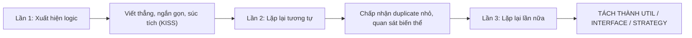

# BỘ QUY ƯỚC VIẾT CODE CLEAN CODE & CHUẨN THIẾT KẾ
## DỰ ÁN: AFFILIATE NEWS, REVIEWS & COUPONS PORTAL
### CÔNG NGHỆ: SPRING BOOT 3.X (JAVA 21) & NEXT.JS 14+ (TYPESCRIPT)

> **Mục tiêu:** Thiết lập tiêu chuẩn viết code cao nhất cho toàn bộ đội ngũ kỹ thuật. Đảm bảo tính nhất quán (Consistency), dễ bảo trì (Maintainability), dễ mở rộng (Scalability), kiểm thử thuận tiện (Testability), tuân thủ triệt để nguyên lý SOLID linh hoạt và Clean Architecture.
> 
> **4 Nguyên tắc tối thượng:**
> 1. **100% English UI Requirement:** Toàn bộ văn bản hiển thị trên giao diện (Client & Admin), nút bấm, nhãn form, thông báo toast, popup xác nhận và response message API đều sử dụng **100% Tiếng Anh (en-US)**.
> 2. **Zero Raw Strings / Magic Values:** Tuyệt đối không viết chuỗi trần rải rác trong code. Toàn bộ phải quy tụ về Constants và Enums có cấu trúc.
> 3. **Shared Utilities:** Tận dụng thư viện dùng chung cho các tác vụ lặp lại (Slug, Date, File, Security, Clipboard, Formatters).
> 4. **Pragmatic SOLID (Tùy cơ ứng biến):** Áp dụng nguyên lý SOLID một cách thực tế, tinh gọn, tránh bẫy Over-Engineering (KISS & YAGNI).

---

## PHẦN 1: QUY ƯỚC CHUẨN BACKEND (SPRING BOOT 3.X & JAVA 21)

### 1. Kiến Trúc Phân Tầng Chuẩn (Clean Layered Architecture)
Toàn bộ mã nguồn backend tuân theo mô hình phân tầng nghiêm ngặt một chiều:
```
Controller (REST API) ➔ Service (Interface & Impl) ➔ Repository (JPA/Specification) ➔ Database
      │                        │
      ▼                        ▼
 Request/Response DTO       Entity (JPA)
```

```
backend/src/main/java/com/bargorya/portal/
├── common/                     # Thư viện dùng chung, Base Entity, Constants, Utils
│   ├── constant/               # SecurityConstants, PermissionConstants, AppConstants, ErrorCodes
│   ├── dto/                    # ApiResponse<T>, PageResponse<T>, ErrorResponse
│   ├── entity/                 # BaseEntity (createdAt, updatedAt, createdBy, isDeleted)
│   ├── exception/              # GlobalExceptionHandler, Custom Domain Exceptions
│   └── util/                   # SlugUtils, DateTimeUtils, SecurityUtils, FileUtils, PaginationUtils
├── config/                     # SecurityConfig, CorsConfig, LiquibaseConfig, WebMvcConfig
├── security/                   # JwtProvider, JwtFilter, UserPrincipal, TotpService
└── modules/                    # Phân chia theo Domain Module (Feature-Driven)
    ├── store/
    │   ├── controller/         # StorePublicController, StoreAdminController
    │   ├── dto/request/        # CreateStoreRequest, UpdateStoreRequest, StoreFilterRequest
    │   ├── dto/response/       # StoreResponse, StoreSummaryResponse, StoreDetailResponse
    │   ├── entity/             # StoreEntity
    │   ├── mapper/             # StoreMapper (MapStruct hoặc Converter)
    │   ├── repository/         # StoreRepository, StoreSpecification
    │   └── service/            # StoreService (Interface) & StoreServiceImpl
    ├── offer/                  # Quản lý Coupon / Deal
    ├── post/                   # Quản lý Bài viết / Review
    ├── category/               # Danh mục
    ├── role/                   # RBAC Dynamic Permissions & Roles
    └── user/                   # Tài khoản & Xác thực 2FA
```

---

### 2. Quy Chuẩn Bắt Buộc Về DTO Pattern (Tuyệt Đối Không Để Lộ Entity)
1. **NGUYÊN TẮC BẤT DI BẤT DỊCH:**
   - **TUYỆT ĐỐI KHÔNG** trả về JPA `@Entity` từ bất kỳ `@RestController` nào.
   - Luôn luôn chuyển đổi Entity thành `ResponseDTO` trước khi trả về Client.
   - Nhận dữ liệu đầu vào thông qua `RequestDTO`, không bao giờ bind thẳng dữ liệu HTTP Request vào Entity.
2. **Sử dụng Java 21 Record hoặc Lombok DTO:**
   - Khuyến khích sử dụng **Java 21 `record`** cho các DTO bất biến (Immutable):
   ```java
   public record StoreSummaryResponse(
       Long id,
       String name,
       String slug,
       String logoUrl,
       Integer maxDiscount,
       Double ratingScore,
       Integer activeCouponsCount
   ) {}
   ```
   - Đối với Request DTO có validation, sử dụng Class kết hợp Jakarta Validation:
   ```java
   @Getter
   @Setter
   @NoArgsConstructor
   @AllArgsConstructor
   @Builder
   public class CreateStoreRequest {
       @NotBlank(message = "{" + ValidationMessageConstants.STORE_NAME_REQUIRED + "}")
       @Size(max = 150, message = "{" + ValidationMessageConstants.STORE_NAME_MAX_LENGTH + "}")
       private String name;

       @NotBlank(message = "{" + ValidationMessageConstants.STORE_SLUG_REQUIRED + "}")
       @Pattern(regexp = RegexConstants.SLUG_PATTERN, message = "{" + ValidationMessageConstants.SLUG_INVALID + "}")
       private String slug;

       @URL(message = "{" + ValidationMessageConstants.URL_INVALID + "}")
       private String affiliateUrl;
   }
   ```

---

### 3. Quy Chuẩn Dependency Injection (DI)
- **CẤM** sử dụng `@Autowired` trên field (Field Injection).
- **BẮT BUỘC** sử dụng **Constructor Injection** kết hợp Lombok `@RequiredArgsConstructor` và thuộc tính `private final`:
  ```java
  // ✅ ĐÚNG:
  @Service
  @RequiredArgsConstructor
  public class StoreServiceImpl implements StoreService {
      private final StoreRepository storeRepository;
      private final StoreMapper storeMapper;
      private final StorageService storageService;
  }
  ```

---

### 4. Quy Chuẩn Service Layer & Quản Lý Transaction
1. **Khai báo Interface trước Implementation:** Luôn có `StoreService` (Interface) và `StoreServiceImpl` để phục vụ Inversion of Control, Unit Test Mocking và mở rộng sau này.
2. **Quản lý Transaction (`@Transactional`):**
   - Đặt `@Transactional(readOnly = true)` ở cấp độ Class của Service để tối ưu bộ nhớ Hibernate và tốc độ đọc CSDL.
   - Chỉ đánh dấu `@Transactional` (ghi dữ liệu) trên các method tạo mới, cập nhật hoặc xóa:
   ```java
   @Service
   @RequiredArgsConstructor
   @Transactional(readOnly = true)
   public class StoreServiceImpl implements StoreService {
       private final StoreRepository storeRepository;

       @Override
       public StoreDetailResponse getBySlug(String slug) {
           return storeRepository.findBySlug(slug)
               .map(storeMapper::toDetailResponse)
               .orElseThrow(() -> new ResourceNotFoundException("Store", "slug", slug));
       }

       @Override
       @Transactional // Ghi CSDL
       public StoreDetailResponse create(CreateStoreRequest request) {
           // Business logic...
       }
   }
   ```

---

### 5. Xử Lý Lỗi Tập Trung (Global Exception Handling)
1. **Không nuốt ngoại lệ (Catch and Swallow):** Tuyệt đối không dùng `catch (Exception e) {}` rỗng hoặc chỉ in `e.printStackTrace()`.
2. **Tạo Custom Domain Exception:**
   - `ResourceNotFoundException`, `BadRequestException`, `DuplicateResourceException`, `UnauthorizedException`.
3. **Sử dụng `@RestControllerAdvice` định dạng chuẩn lỗi RFC 7807:**
   ```java
   @RestControllerAdvice
   @Slf4j
   public class GlobalExceptionHandler {

       @ExceptionHandler(ResourceNotFoundException.class)
       public ResponseEntity<ErrorResponse> handleNotFound(ResourceNotFoundException ex, HttpServletRequest request) {
           log.warn("Resource not found: {}", ex.getMessage());
           ErrorResponse error = ErrorResponse.builder()
               .timestamp(Instant.now())
               .status(HttpStatus.NOT_FOUND.value())
               .error(HttpStatus.NOT_FOUND.getReasonPhrase())
               .errorCode(ErrorCodes.RESOURCE_NOT_FOUND)
               .message(ex.getMessage())
               .path(request.getRequestURI())
               .build();
           return ResponseEntity.status(HttpStatus.NOT_FOUND).body(error);
       }
   }
   ```

---

### 6. Quy Chuẩn Định Dạng Chuẩn Phản Hồi API (Unified REST Contract)
Mọi API trả về đều được bao bọc (Enveloped) trong cấu trúc thống nhất:
```java
public record ApiResponse<T>(
    boolean success,
    String message,
    T data,
    Instant timestamp
) {
    public static <T> ApiResponse<T> ok(T data) {
        return new ApiResponse<>(true, MessageConstants.SUCCESS, data, Instant.now());
    }
    public static <T> ApiResponse<T> ok(String message, T data) {
        return new ApiResponse<>(true, message, data, Instant.now());
    }
}
```

---

## PHẦN 2: QUY TẮC "ZERO RAW STRINGS" (QUẢN LÝ HẰNG SỐ TOÀN DIỆN)

> **Luật bất di bất dịch:** Không bao giờ gõ trực tiếp một chuỗi ký tự tự do (Magic Strings) hay số nguyên vô căn cứ (Magic Numbers) bên trong Controller, Service, Component hay Hooks. Mọi giá trị đều phải được định nghĩa trong `Constants` hoặc `Enums`.

### 1. Phân Chia Hằng Số Backend (`common/constant/`)
```
backend/src/main/java/com/bargorya/portal/common/constant/
├── AppConstants.java           # Tên app, múi giờ mặc định, định dạng ngày tháng
├── SecurityConstants.java      # Token header, Token prefix, Secret expirations
├── PermissionConstants.java    # Quyền RBAC (STORE_VIEW, STORE_CREATE, POST_EDIT...)
├── ErrorCodes.java             # Mã lỗi hệ thống (STORE_NOT_FOUND, INVALID_CREDENTIALS...)
├── PaginationConstants.java    # DEFAULT_PAGE = 0, DEFAULT_PAGE_SIZE = 20, MAX_PAGE_SIZE = 100
├── StorageConstants.java       # Thư mục upload, dung lượng tối đa, mime-types cho phép
├── RegexConstants.java         # Regex slug, email, phone, password policy
└── ValidationMessageConstants.java # Mã thông điệp lỗi cho Bean Validation
```

#### Ví dụ chuẩn trong Backend:
```java
// ❌ SAI (Hardcode raw string):
if (user.getRole().equals("ADMIN")) { ... }
if (file.getSize() > 5242880) { ... }
return "redirect:/backend/stores";

// ✅ ĐÚNG (Gọi từ Constant hoặc Enum):
if (RoleType.ADMIN.equals(user.getRole())) { ... }
if (file.getSize() > StorageConstants.MAX_IMAGE_FILE_SIZE_BYTES) { ... }
```

### 2. Phân Chia Hằng Số Frontend (`src/constants/`)
```
frontend/src/constants/
├── routes.ts                   # Toàn bộ URL đường dẫn (Public & Admin)
├── api-endpoints.ts            # Toàn bộ URI endpoint gọi backend
├── storage-keys.ts             # Key localStorage, sessionStorage, cookie
├── seo-defaults.ts             # Meta title mẫu, site name, default OG image
├── ui-constants.ts             # Kích thước phân trang, thời gian debounce, animation duration
└── regex.ts                    # Regex kiểm tra form
```

#### Ví dụ chuẩn trong Frontend (`routes.ts` & `api-endpoints.ts`):
```typescript
// src/constants/routes.ts
export const ROUTES = {
  PUBLIC: {
    HOME: '/',
    STORES: '/stores',
    STORE_DETAIL: (slug: string) => `/store/${slug}`,
    POSTS: '/posts',
    POST_DETAIL: (slug: string) => `/post/${slug}`,
    GO_AFFILIATE: (slug: string) => `/go/${slug}`,
  },
  ADMIN: {
    DASHBOARD: '/admin/dashboard',
    STORES: '/admin/stores',
    STORE_CREATE: '/admin/stores/create',
    STORE_EDIT: (id: number | string) => `/admin/stores/${id}/edit`,
    OFFERS: '/admin/offers',
    POSTS: '/admin/posts',
    USERS: '/admin/users',
    ROLES: '/admin/roles',
    SETTINGS_SEO: '/admin/settings/seo',
  },
  AUTH: {
    LOGIN: '/login',
    TWO_FACTOR: '/verify-2fa',
  },
} as const;

// src/constants/api-endpoints.ts
export const API_ENDPOINTS = {
  AUTH: {
    LOGIN: '/api/v1/auth/login',
    VERIFY_2FA: '/api/v1/auth/verify-2fa',
    REFRESH: '/api/v1/auth/refresh',
  },
  STORES: {
    PUBLIC_LIST: '/api/v1/stores',
    PUBLIC_DETAIL: (slug: string) => `/api/v1/stores/${slug}`,
    ADMIN_LIST: '/api/v1/admin/stores',
    ADMIN_DETAIL: (id: number) => `/api/v1/admin/stores/${id}`,
  },
} as const;
```

---

## PHẦN 3: HỆ THỐNG THƯ VIỆN TIỆN ÍCH DÙNG CHUNG (SHARED UTILS)

> **Nguyên tắc Util:** Các hàm tiện ích phải là **Pure Functions** (Hàm thuần túy: cùng input luôn cho cùng output, không phụ thuộc trạng thái bên ngoài, không gây side effect).

### 1. Backend Shared Utils (`common/util/`)
1. **`SlugUtils`:**
   - Tự động chuyển đổi chuỗi bất kỳ (tiếng Việt có dấu, ký tự đặc biệt) thành slug chuẩn URL SEO (`kebab-case`).
   - Xử lý loại bỏ dấu thanh, thay thế ký tự lạ bằng gạch ngang, xóa gạch ngang thừa.
2. **`DateTimeUtils`:**
   - Chuyển đổi `Instant` sang chuỗi ngày giờ theo định dạng chuẩn (`dd/MM/yyyy HH:mm:ss`).
   - Sinh chuỗi tháng và năm hiện tại bằng tiếng Anh phục vụ Dynamic SEO Title (ví dụ: `October 2026`).
   - Tính toán thời gian tương đối ("5 phút trước", "2 ngày trước").
3. **`SecurityUtils`:**
   - `getCurrentUserId()`: Lấy `Long userId` của user đang đăng nhập từ `SecurityContextHolder`.
   - `getCurrentUsername()`: Lấy username an toàn.
   - `hasRole(RoleType role)`: Kiểm tra quyền nhanh gọn mà không cần ép kiểu thủ công.
4. **`FileUtils`:**
   - Trích xuất phần mở rộng file (extension).
   - Kiểm tra định dạng hợp lệ (chỉ cho phép `.jpg`, `.jpeg`, `.png`, `.webp`).
   - Chuẩn hóa tên file: chống lỗ hổng **Path Traversal** (`../`).
5. **`PaginationUtils`:**
   - Tạo đối tượng `Pageable` với kiểm soát kích thước trang an toàn (không để client request `size=1000000` gây nghẽn RAM).

### 2. Frontend Shared Utils (`src/lib/utils/`)
1. **`cn()` (`src/lib/utils/cn.ts`):** Kết hợp `clsx` và `tailwind-merge` để xử lý xung đột class Tailwind CSS linh hoạt.
2. **`clipboard.ts`:**
   - Sao chép mã coupon vào bộ nhớ tạm thời.
   - Có cơ chế **Fallback 2 lớp**: Ưu tiên `navigator.clipboard.writeText`, nếu chạy trên WebView (TikTok, Facebook in-app browser) bị chặn thì tự động kích hoạt `document.execCommand('copy')`.
3. **`formatters.ts`:**
   - `formatDiscount(type, value)`: Định dạng hiển thị `% Off`, `$ Off`, `Free Shipping`.
   - `formatNumber(value)`: Định dạng số phân tách hàng nghìn (`1,500`).
   - `formatDate(dateString)`: Hiển thị ngày tháng theo locale.
4. **`url.ts`:**
   - Tạo URL có gắn tham số UTM tracking an toàn.
   - Lọc bỏ các param rỗng hoặc null khi gửi search query.

---

## PHẦN 4: NGUYÊN LÝ SOLID LINH HOẠT - TÙY CƠ ỨNG BIẾN (PRAGMATIC SOLID)

> **Triết lý sống còn:** Áp dụng nguyên lý SOLID **thực tế - linh hoạt - không giáo điều**. Tránh tuyệt đối bẫy **Over-Engineering**, không tạo ra các tầng trung gian rỗng tuếch làm phức tạp hóa vấn đề (tuân thủ **KISS - Keep It Simple, Stupid** và **YAGNI - You Aren't Gonna Need It**).

### 1. Single Responsibility Principle (S - Trách nhiệm đơn nhất)
- **Đúng:** Mỗi Class / Service / Component tập trung giải quyết trọn vẹn 1 nghiệp vụ. `StoreService` chỉ xử lý Store; `StorageService` chỉ xử lý lưu trữ file.
- **Tùy cơ ứng biến (Tránh cực đoan):** Không chia nhỏ đến mức tạo ra mỗi method 1 class riêng (Command Pattern mù quáng). Nếu nghiệp vụ đơn giản (như đổi trạng thái boolean `isActive`), viết trực tiếp trong `StoreService`, không cần đẻ thêm `StoreActivationHandler`.

### 2. Open/Closed Principle (O - Mở để mở rộng, Đóng để sửa đổi)
- **Đúng:** Thiết kế các điểm giao tiếp chiến lược bằng **Interface**:
  - `StorageService` (Interface): Hiện tại dùng `LocalStorageServiceImpl` (lưu ổ cứng VPS). Mai sau mở rộng sang Cloudflare R2 hay AWS S3 chỉ cần viết thêm `S3StorageServiceImpl` và đổi cấu hình `@ConditionalOnProperty`, không sửa 1 dòng code nghiệp vụ nào của Store hay Post.
- **Tùy cơ ứng biến:** Không ép mọi entity hay hàm nhỏ đều phải có Interface nếu bản chất nghiệp vụ đó chỉ có duy nhất 1 cách thực hiện vĩnh viễn trong phạm vi dự án.

### 3. Liskov Substitution Principle (L - Thay thế Liskov)
- Mọi implementation đều phải tuân thủ nghiêm ngặt giao kèo (contract) của Interface.
- Không bao giờ ném `UnsupportedOperationException` trong phương thức đã cam kết của interface. Nếu một class con không thể thực hiện phương thức đó, tức là Interface đang bị thiết kế sai.

### 4. Interface Segregation Principle (I - Phân tách giao diện)
- Interface phải tinh gọn, vừa vặn theo từng mục đích.
- Không tạo ra các "Fat Interface" chứa 30-40 phương thức hỗn tạp ép các service phải implement những hàm không thuộc về mình.

### 5. Dependency Inversion Principle (D - Đảo ngược phụ thuộc)
- Tầng cao không phụ thuộc vào chi tiết tầng thấp, cả 2 phụ thuộc vào trừu tượng (Abstraction).
- Controller tiêm Service Interface; Service tiêm Repository Interface.

### 6. Quy Tắc "Luật Số Ba" (The Rule of Three - Khi nào nên trừu tượng hóa?)

- **Không áp dụng Design Pattern trước khi có nhu cầu thực tế:** Không tạo Factory, Strategy, Builder phức tạp cho những tính năng CRUD cơ bản. Chỉ trừu tượng hóa khi đã nhìn thấy rõ **từ 2 đến 3 biến thể nghiệp vụ thực tế**.

---

## PHẦN 5: BẢNG SO SÁNH QUY ƯỚC ĐÚNG VS. SAI TOÀN DIỆN (DO'S & DON'TS)

| Hạng mục | ❌ TUYỆT ĐỐI KHÔNG LÀM (BAD PRACTICE) | ✅ BẮT BUỘC TUÂN THỦ (BEST PRACTICE) |
| :--- | :--- | :--- |
| **Magic Strings** | Viết chuỗi trần: `"ADMIN"`, `"/api/v1/stores"`, `"store_name"` | Dùng `RoleType.ADMIN`, `API_ENDPOINTS.STORES`, `StorageConstants` |
| **Route Links** | Hardcode link trong component: `<Link href="/admin/stores">` | Dùng Constant: `<Link href={ROUTES.ADMIN.STORES}>` |
| **Spring DTO** | Trả trực tiếp `@Entity` qua `@RestController` | Luôn chuyển đổi sang `ResponseDTO` (Java 21 `record`) |
| **Spring DI** | Dùng `@Autowired` trên thuộc tính lớp (Field Injection) | Dùng `@RequiredArgsConstructor` + `private final` |
| **Spring CRUD** | Viết logic nghiệp vụ, tính toán trực tiếp trong Controller | Controller chỉ nhận request, ủy quyền cho Service xử lý |
| **Spring Error** | Nuốt lỗi bằng `try {} catch(Exception e) {}` | Ném Custom Exception và xử lý qua `@RestControllerAdvice` |
| **Spring Read** | Không khai báo `@Transactional` trên Service | Đánh dấu `@Transactional(readOnly = true)` cấp lớp |
| **Shared Utils** | Viết lại logic tạo slug, format date ở nhiều service/component | Gọi từ `SlugUtils`, `DateTimeUtils`, `formatters.ts` |
| **SOLID Design** | Tạo 10 tầng class rỗng cho 1 hàm CRUD đơn giản (Over-engineer) | Áp dụng Pragmatic SOLID: Giữ đơn giản, chỉ trừu tượng khi có >2 biến thể |
| **Next.js Render** | Đặt `'use client';` ở đầu toàn bộ file `page.tsx` | Giữ page là Server Component, chỉ bọc client ở component con |
| **Next.js Data** | Dùng `useEffect` để fetch dữ liệu SEO trên Client | Fetch dữ liệu trực tiếp trong Server Component |
| **TypeScript** | Khai báo kiểu `any` hoặc không định nghĩa props | Bật strict mode, định nghĩa Interface cho mọi object/props |
| **Next.js Image** | Dùng thẻ HTML `` thuần | Dùng `next/image` có `width`, `height`, `alt`, `priority` |
| **CSS Styling** | Nối chuỗi className thủ công dạng `className={"" + ""}` | Dùng hàm `cn(...)` (`clsx` + `tailwind-merge`) |
| **Logging** | Dùng `System.out.println()` hoặc `e.printStackTrace()` | Dùng `@Slf4j` với parameter `{}` |
