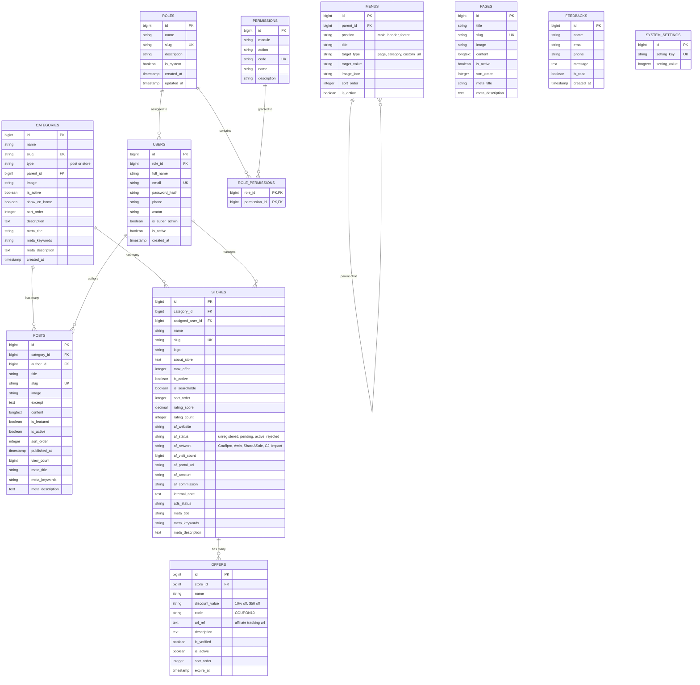
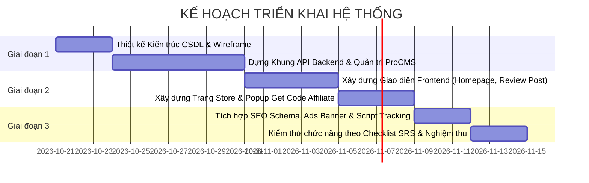

# TÀI LIỆU ĐẶC TẢ YÊU CẦU PHẦN MỀM (SRS)
## HỆ THỐNG CỔNG TIN TỨC & TIẾP THỊ LIÊN KẾT (AFFILIATE NEWS & COUPON PORTAL)
*(Chuẩn hóa theo kiến trúc website mẫu Bargorya & hệ thống quản trị ProCMS)*

---

## 1. GIỚI THIỆU TỔNG QUAN (INTRODUCTION)

### 1.1. Mục đích tài liệu
Tài liệu Đặc tả Yêu cầu Phần mềm (SRS - Software Requirements Specification) này mô tả chi tiết, đầy đủ toàn bộ yêu cầu chức năng (Functional Requirements), phi chức năng (Non-Functional Requirements), thiết kế dữ liệu (Data Schema), và luồng xử lý (Business Workflows) cho hệ thống **Cổng Tin Tức & Tổng Hợp Mã Giảm Giá Affiliate**.
Tài liệu được xây dựng dưới dạng **Checklist kiểm thử từng tính năng** giúp Chủ dự án (Product Owner / User) và Đội ngũ phát triển (Developers / QA) có thể rà soát, nghiệm thu từng màn hình và tính năng một cách chính xác nhất.

### 1.2. Mục tiêu hệ thống
1. **Thu hút lưu lượng truy cập tự nhiên (Organic Traffic SEO):** Thông qua hệ thống xuất bản bài viết tin tức, bài phân tích xu hướng và bài đánh giá sản phẩm (Product Reviews) chất lượng cao.
2. **Tối đa hóa chuyển đổi Affiliate (Conversion Rate):** Cung cấp các trang Cửa hàng thương hiệu (Store) chứa mã giảm giá (Coupon Code), ưu đãi (Deals) kèm cơ chế bật Popup Copy Mã và tự động mở link affiliate sang website nhãn hàng.
3. **Quản trị quy mô lớn (High Scale ProCMS):** Quản lý tập trung hàng ngàn cửa hàng đối tác (hơn 3,700+ stores), hàng chục ngàn offers, tích hợp đa mạng lưới affiliate (ShareASale, Awin, Goaffpro, Impact...) và phân quyền nhân sự chi tiết.

### 1.3. Mô hình Vai trò Người dùng & Phân quyền Động (Dynamic Role & User Model)
Hệ thống không áp đặt cứng danh sách các vai trò nhân sự mà triển khai theo **cơ chế Phân quyền Động hoàn toàn (Dynamic RBAC)** theo quy trình 3 bước linh hoạt:

1. **Hai vai trò mặc định ban đầu (Default System Roles):**
   * **`Admin` (Quản trị viên tối cao)**: Toàn quyền quản trị hệ thống, sở hữu 100% tính năng. Có quyền tự tạo Role mới, cấu hình phân quyền, tạo/khóa tài khoản nhân sự, cài đặt hệ thống, SEO và tracking.
   * **`Nhân viên` (Nhân viên vận hành mặc định)**: Vai trò cơ sở ban đầu được cấp sẵn các quyền thao tác nội dung thông thường (soạn bài viết, cập nhật mã giảm giá, kiểm tra store theo phân công; không có quyền quản lý tài khoản và cài đặt hệ thống).

2. **Quy trình Quản trị Phân quyền 3 bước linh hoạt của Doanh nghiệp:**
   * **Bước 1 - Tự tạo Role mới (Add Custom Role):** Quản trị viên có thể tự bấm "+ Thêm mới Role" để tạo bất kỳ vai trò mới nào theo nhu cầu thực tế của công ty (ví dụ: *Cộng tác viên Review, Nhân viên Chạy Ads, Nhân viên SEO, Trưởng nhóm Affiliate, Nhân viên Đăng Coupon...*).
   * **Bước 2 - Tự gán tính năng/quyền vào Role (Assign Permissions):** Trong mỗi Role, Quản trị viên tự tích chọn các tính năng cụ thể mà vai trò này được phép làm (ví dụ: Role *Cộng tác viên* chỉ có quyền Xem và Thêm bài viết, không được Xóa; Role *Nhân viên Coupon* chỉ có quyền Thêm/Sửa mã giảm giá...).
   * **Bước 3 - Tự thêm User và gán vào Role (Create User & Assign Role):** Khi tạo tài khoản nhân sự mới, Quản trị viên chỉ cần chọn Role tương ứng từ danh sách để gán. Tài khoản nhân viên sẽ ngay lập tức có đầy đủ các quyền hạn đã được cấu hình trong Role đó.

3. **Người dùng công khai ngoài website (Guest / Độc giả):**
   * Độc giả vãng lai truy cập web không cần đăng nhập: Xem bài viết tin tức, tìm kiếm mã giảm giá, nhấp lấy mã coupon affiliate, gửi form liên hệ feedback.

---

## 2. CHECKLIST YÊU CẦU CHỨC NĂNG PHÂN HỆ FRONTEND (NGƯỜI DÙNG)

> **Hướng dẫn sử dụng:** Đánh dấu `[x]` khi chức năng đã hoàn thành và nghiệm thu đạt chuẩn.

### 2.1. Khối Header, Topbar & Navigation (Dùng chung toàn trang)
- [ ] **FE-NAV-01 (Top Bar - Hiển thị ngày tháng):** Tự động hiển thị thứ, ngày, tháng, năm theo thời gian thực (ví dụ: *Mon, Oct 19, 2026*).
- [ ] **FE-NAV-02 (Top Bar - Menu phụ):** Hiển thị các liên kết nhanh: *About Us*, *Privacy Policy*, *Tech*, *Business*, *Contact Us*.
- [ ] **FE-NAV-03 (Top Bar - Mạng xã hội):** Hiển thị các icon mạng xã hội có liên kết ngoài: X (Twitter), Instagram, YouTube, Facebook, TikTok, Pinterest (mở tab mới).
- [ ] **FE-NAV-04 (Main Header - Logo & Slogan):** Hiển thị logo thương hiệu chuẩn SVG/PNG sắc nét và slogan phụ (*"Smart News & Hot Deals - Save More Daily"*). Nhấp vào logo chuyển về Trang chủ.
- [ ] **FE-NAV-05 (Main Header - Banner quảng cáo):** Vị trí hiển thị banner quảng cáo chuẩn (kích thước 728x90 trên Desktop, tự co giãn trên Mobile) kèm nhãn "Advertisement". Hỗ trợ chèn ảnh + link affiliate hoặc mã script Google AdSense.
- [ ] **FE-NAV-06 (Navigation Bar - Menu chính):** Thanh menu ngang hiển thị động từ CSDL (Home, About Us, Tech, Business, Contact Us, Entertainment, US Politics...). Hỗ trợ dropdown menu đa cấp mượt mà trên Desktop và Off-canvas drawer menu trên Mobile.
- [ ] **FE-NAV-07 (Navigation Bar - Nút tìm kiếm nhanh):** Icon kính lúp ở góc phải menu. Khi bấm hiển thị thanh search overlay hoặc modal tìm kiếm tức thì.
- [ ] **FE-NAV-08 (Trending Tags Bar):** Thanh danh sách hashtag nổi bật (#Trump, #Google, #Educational Toys...). Nhấp vào tag chuyển hướng đến trang danh sách bài viết theo tag tương ứng.
- [ ] **FE-NAV-09 (Flash News Ticker):** Dải tin tức khẩn cấp/tin mới nhất có badge đỏ "Flash News" với hiệu ứng chữ cuộn ngang (Marquee / Swiper) hiển thị tiêu đề các bài review/tin mới nhất.

---

### 2.2. Trang chủ (Homepage)
- [ ] **FE-HOME-01 (Hero Section - Tin tiêu điểm lớn):**
  - [ ] Hiển thị 1 bài viết nổi bật nhất (Featured Post) với ảnh thumbnail khổ lớn (tối thiểu 1280x720).
  - [ ] Hiển thị badge danh mục bài viết nổi bật.
  - [ ] Hiển thị tiêu đề bài viết (Typography to bản, dễ đọc).
  - [ ] Hiển thị thông tin tác giả và ngày đăng bài.
- [ ] **FE-HOME-02 (Hero Section - Khối "Editor Pick"):**
  - [ ] Cột bên phải gồm 4 bài viết được ban biên tập chọn lọc.
  - [ ] Bố cục gọn: Ảnh thumbnail nhỏ hình vuông/chữ nhật + Tiêu đề bài viết.
- [ ] **FE-HOME-03 (Khối chuyên mục - Layout Grid 3 cột):**
  - [ ] Áp dụng cho chuyên mục ví dụ "Business" với nút "View All >" trỏ đến trang danh mục.
  - [ ] 3 thẻ bài viết nằm ngang đều nhau, hình ảnh bo góc 8px-12px, badge danh mục, tiêu đề 2-3 dòng, tác giả, ngày đăng.
- [ ] **FE-HOME-04 (Khối chuyên mục - Layout Split 1 Lớn + 3 Nhỏ):**
  - [ ] Áp dụng cho chuyên mục ví dụ "Tech" với nút "View All >".
  - [ ] Cột trái: 1 bài tiêu điểm lớn với ảnh to, tiêu đề và trích đoạn mô tả ngắn (excerpt).
  - [ ] Cột phải: 3 bài viết dạng danh sách dọc (ảnh thumbnail bên trái, tiêu đề + tag + ngày bên phải).
- [ ] **FE-HOME-05 (Các khối chuyên mục bổ sung):**
  - [ ] Khối danh mục "Climate", "US Politics", "Entertainment"... linh hoạt cấu hình theo cài đặt admin.
- [ ] **FE-HOME-06 (Footer toàn trang):**
  - [ ] Cột 1: Logo chân trang, tóm tắt sứ mệnh website, thông tin bản quyền.
  - [ ] Cột 2: Danh mục tin tức chính.
  - [ ] Cột 3: Liên kết nhanh trang tĩnh (About Us, Contact Us, Privacy Policy, Terms).
  - [ ] Cột 4: Mạng xã hội & Khuyến cáo tiếp thị liên kết (Affiliate Disclaimer).

---

### 2.3. Trang chi tiết bài viết (Article / Review Single Page)
- [ ] **FE-POST-01 (Breadcrumb):** Điều hướng phân cấp (Trang chủ > Danh mục cha > Danh mục con > Tiêu đề bài viết).
- [ ] **FE-POST-02 (Tiêu đề & Thông tin bài viết):** Thẻ `<h1>` chứa tiêu đề bài viết, danh mục đính kèm (Category badge), thông tin tác giả, ngày đăng, thời gian đọc ước tính.
- [ ] **FE-POST-03 (Ảnh đại diện bài viết):** Hiển thị Featured Image kích thước chuẩn, chất lượng cao, có alt tag tối ưu SEO.
- [ ] **FE-POST-04 (Nội dung chi tiết):**
  - [ ] Hỗ trợ định dạng Rich Text đầy đủ (H2, H3, bôi đậm, in nghiêng, danh sách, trích dẫn Quote, hình ảnh nội dung kèm caption).
  - [ ] Hỗ trợ nhúng bảng biểu so sánh sản phẩm, hộp ưu/nhược điểm (Pros & Cons).
  - [ ] Hỗ trợ hộp kêu gọi hành động Affiliate CTA Box (ảnh sản phẩm, giá ưu đãi, nút "Buy Now" / "Check Price" trỏ link affiliate).
- [ ] **FE-POST-05 (Sidebar bài viết):**
  - [ ] Ô tìm kiếm (Search Box).
  - [ ] Widget "Recent Posts" (5 bài viết mới nhất có thumbnail).
  - [ ] Widget "Categories" (Danh sách danh mục bài viết).
  - [ ] Widget Banner quảng cáo gắn link tiếp thị.
- [ ] **FE-POST-06 (Khối bài viết liên quan):** Gợi ý 3 - 6 bài viết cùng chuyên mục ở cuối bài.

---

### 2.4. Trang Cửa hàng Thương hiệu & Mã giảm giá (Store & Coupon Page)
- [ ] **FE-STORE-01 (Sidebar Thông tin Store):**
  - [ ] Logo cửa hàng (Store Logo) nền trắng sắc nét.
  - [ ] Tên cửa hàng (Store Name).
  - [ ] Hệ thống đánh giá sao tương tác (Star rating, số lượt vote, nút "Rate it").
  - [ ] Nút "Get Coupon Alert" (bật modal nhập email để nhận thông báo khuyến mãi mới).
  - [ ] Bảng tóm tắt thống kê (Summary Stats Widget):
    * Tổng số Coupons (Coupons count).
    * Số mã đã kiểm tra dùng tốt (Verified Coupons count).
    * Số mã nhập tay (Coupon Codes count).
    * Số ưu đãi tự động kích hoạt (Deals count).
    * Mức giảm tốt nhất (Best Offer, ví dụ: 10% Off, $50 Off).
- [ ] **FE-STORE-02 (Phần tiêu đề danh sách ưu đãi):**
  - [ ] Tiêu đề chính dạng: *"[Tên Store] Coupons and Promo Codes (Last Updated: MM/DD/YYYY)"*.
  - [ ] Đoạn mô tả giới thiệu ngắn và lời kêu gọi tiết kiệm mua sắm.
- [ ] **FE-STORE-03 (Bộ lọc phân loại Offers):**
  - [ ] Tab `All (N)`: Hiển thị toàn bộ ưu đãi của cửa hàng.
  - [ ] Tab `Verified (N)`: Chỉ hiển thị các mã đã được admin đánh dấu xác minh hoạt động.
  - [ ] Tab `Codes (N)`: Chỉ hiển thị các ưu đãi có chứa mã giảm giá (Coupon Code).
  - [ ] Tab `Deals (N)`: Chỉ hiển thị các ưu đãi giảm trực tiếp theo link, không cần nhập mã.
- [ ] **FE-STORE-04 (Thẻ Coupon / Deal Card):**
  - [ ] Badge mức giảm giá to bản bên trái (ví dụ: `10% Off`, `Free Shipping`, `$100 Off`).
  - [ ] Huy hiệu kiểm định xanh: `Verified Code`.
  - [ ] Tiêu đề ưu đãi (Offer Title).
  - [ ] Mô tả chi tiết ưu đãi và điều kiện áp dụng (Description/Terms).
  - [ ] Nút bấm hành động phong cách Coupon vé cắt (Dashed cut edge):
    * Đối với Code: Hiển thị nút **"Get Code"** che một phần mã code.
    * Đối với Deal: Hiển thị nút **"Get Deal"** / **"Activate Deal"**.
- [ ] **FE-STORE-05 (Cơ chế Popup "Get Code" & Kích hoạt Affiliate Tab Mới):**
  - [ ] Khi độc giả bấm nút **"Get Code"**:
    * **Hành động 1 (Affiliate Redirect):** Tự động mở tab trình duyệt mới trỏ đến đường dẫn Affiliate Tracking của Store/Offer (chứa mã hoa hồng của hệ thống).
    * **Hành động 2 (Modal Popup tại trang hiện tại):** Hiển thị cửa sổ Popup Modal trên trang hiện tại.
    * **Hành động 3 (URL Update):** Cập nhật query parameter trên URL dạng `?offer=[id]` để người dùng có thể chia sẻ trực tiếp link popup này.
- [ ] **FE-STORE-06 (Chi tiết Modal Popup Get Code):**
  - [ ] Logo của Store.
  - [ ] Tiêu đề Offer.
  - [ ] Dòng hướng dẫn: *"Copy the code and go to [Store Name]"*.
  - [ ] Khung hiển thị mã giảm giá chữ in hoa nổi bật viền nét đứt (ví dụ: `DOCTORNEVERA`).
  - [ ] Nút **"Tap To Copy"**: Khi bấm sẽ tự động copy mã vào bộ nhớ đệm (Clipboard) và đổi trạng thái nút thành *"Copied!"*.
  - [ ] Nút/Link *"More [Store Name] >>"*: Cuộn xem các ưu đãi khác cùng store.
  - [ ] Nút đóng Popup (`X` hoặc nhấp ra ngoài backdrop).
- [ ] **FE-STORE-07 (Khối "About Store" chuẩn SEO cuối trang Store):**
  - [ ] Tự động render bài giới thiệu thương hiệu từ backend nhằm tối ưu Onpage SEO.
  - [ ] Bố cục cấu trúc 4 mục chuẩn:
    * *Who We Are* (Thương hiệu là ai).
    * *What We Offer* (Sản phẩm/Dịch vụ cung cấp).
    * *Why Choose Us* (Lý do chọn thương hiệu này).
    * *Our Mission & Vision* (Sứ mệnh và tầm nhìn).

- [ ] **FE-STORE-08 (Tối ưu hóa Giao diện Mobile-First khi gắn link trên Social Bio/Post):**
  - [ ] Vì hơn 90% lưu lượng truy cập từ Social (TikTok, Facebook, Instagram, YouTube, X) là điện thoại di động, trang Store phải hoạt động như một **Landing Page / Bio Link thương hiệu chuyên nghiệp**:
    * Thời gian tải trang cực nhanh (<1.2 giây trên mạng 4G/5G).
    * Phần Header Store trên mobile được gom gọn: Logo, Tên nhãn hàng, Sao uy tín, Nút nhận thông báo mã.
    * Danh sách mã giảm giá hiển thị dạng thẻ dọc bo tròn, nút "Get Code" to bản, dễ bấm bằng ngón tay cái (Thumb-friendly touch target).
    * Hỗ trợ chế độ xem tối ưu không bị vỡ khung hình trên mọi kích thước màn hình điện thoại (từ iPhone SE đến các dòng Pro Max).

- [ ] **FE-STORE-09 (Tương thích hoàn hảo với In-App Browser / Webview của TikTok, Facebook, Instagram):**
  - [ ] **Chống chặn Popup / Tab mới trong Webview:**
    * Các ứng dụng mạng xã hội (TikTok, Facebook App, Instagram) mở link trong Webview nội bộ và thường chặn lệnh `window.open()`.
    * Hệ thống phải có cơ chế kép (Dual-Action Flow): Khi bấm "Get Code", hệ thống lập tức sao chép mã giảm giá vào Clipboard, sau đó điều hướng mượt mà sang link affiliate của nhãn hàng (hoặc hiển thị thanh thông báo điều hướng nếu Webview chặn tab mới).
  - [ ] **Cơ chế Copy Mã an toàn đa nền tảng (Clipboard Fallback):**
    * Tích hợp `navigator.clipboard.writeText()` chuẩn hiện đại.
    * Tự động kích hoạt cơ chế dự phòng `document.execCommand('copy')` với textarea ẩn khi chạy trong các môi trường Webview ngặt nghèo của iOS/Android, đảm bảo 100% người dùng bấm là sao chép thành công.

- [ ] **FE-STORE-10 (Thẻ chia sẻ Mạng xã hội động - Dynamic Open Graph / Twitter Card per Store):**
  - [ ] Khi link Store (ví dụ: `https://bargorya.com/store/nilight-store`) được dán vào bài viết Facebook, tin nhắn Messenger, Zalo, Twitter/X, Telegram, Discord, Pinterest... hệ thống tự động sinh bản xem trước (Social Card Preview) cực kỳ bắt mắt:
    * `og:title`: Tự động tạo tiêu đề giật tít thu hút click: *"[Store Name] Coupons & Promo Codes 2026 - Verified Up to [Max Discount]% Off"*.
    * `og:description`: Lời kêu gọi hành động: *"Get verified discount codes and exclusive deals for [Store Name]. Tap to copy code and save today!"*.
    * `og:image`: Ảnh preview kích thước chuẩn 1200x630 hiển thị rõ nét: Logo Store trên nền thương hiệu + Badge mức giảm giá cao nhất (ví dụ: *Save 10% Off*) + Huy hiệu *Verified Deals*.
    * `twitter:card`: Đặt chuẩn `summary_large_image`.

- [ ] **FE-STORE-11 (Ghi nhận nguồn Traffic Social & Chuyển tiếp UTM / Sub-ID vào Link Affiliate):**
  - [ ] Khi gắn link store lên Social kèm tham số UTM (ví dụ: `?utm_source=tiktok&utm_medium=bio` hoặc `?source=facebook_reel&subid=video01`):
    * Hệ thống Frontend tự động bắt các tham số này và lưu vào Session.
    * Khi người dùng bấm bất kỳ nút "Get Code" nào trong trang store, hệ thống sẽ **tự động nối các tham số tracking này (Sub-ID, Click-ID) vào URL Affiliate cuối cùng** (Awin, ShareASale, Goaffpro...).
    * Đảm bảo báo cáo doanh thu trên mạng Affiliate thể hiện chính xác chuyển đổi đến từ video TikTok, bài post Facebook hay kênh nào.

- [ ] **FE-STORE-12 (Thanh công cụ Chia sẻ Nhanh - Quick Social Share & Copy Link):**
  - [ ] Nút "Share Store": Cho phép người dùng hoặc đội ngũ CTV click 1 chạm để chia sẻ nhanh link Store lên Facebook, X, Telegram, WhatsApp, Zalo hoặc bấm "Copy Link" có gắn sẵn tag chiến dịch.

---

### 2.5. Trang Tìm kiếm & Trang Nội dung tĩnh (Search & Static Pages)
- [ ] **FE-SEARCH-01:** Trang kết quả tìm kiếm hỗ trợ tìm kiếm bài viết tin tức và tìm kiếm cửa hàng/mã giảm giá.
- [ ] **FE-PAGE-01:** Trang tĩnh About Us (Giới thiệu dự án, giá trị mang lại).
- [ ] **FE-PAGE-02:** Trang tĩnh Contact Us kèm Form liên hệ (Họ tên, Email, Số điện thoại, Nội dung tin nhắn -> gửi về Backend Feedback).
- [ ] **FE-PAGE-03:** Trang chính sách bảo mật (Privacy Policy), Điều khoản dịch vụ (Terms of Service), Chính sách tiết lộ tiếp thị liên kết (Affiliate Disclosure).

---

## 3. CHECKLIST YÊU CẦU CHỨC NĂNG PHÂN HỆ BACKEND ADMIN (ProCMS)

### 3.1. Phân hệ Quản lý Tin tức (Post Management - Ảnh 1, 2, 3)
- [ ] **BE-POST-01 (Danh sách bài viết):**
  - [ ] Bảng dữ liệu hiển thị: ID, Tên bài viết, Ảnh thumbnail, Danh mục cha, Trạng thái hiển thị (Có/Không - hỗ trợ chuyển trạng thái trực tiếp), Thứ tự sắp xếp (STT), Ngày tạo.
  - [ ] Thanh tìm kiếm bài viết theo từ khóa tiêu đề.
  - [ ] Bộ lọc theo Danh mục bài viết (Dropdown select).
  - [ ] Bộ lọc theo Trạng thái xuất bản (Tất cả, Đang hiển thị, Ẩn).
  - [ ] Nút thao tác nhanh: Cập nhật thay đổi hàng loạt (Bulk Update), Thêm mới, Xóa đã chọn.
  - [ ] Cột Actions từng dòng: Nút Xem bài viết ngoài web (icon mắt xanh lá), Sửa (icon bút xanh dương), Xóa (icon thùng rác đỏ).
- [ ] **BE-POST-02 (Form Thêm / Sửa bài viết):**
  - [ ] `Tên bài viết`: Input text bắt buộc.
  - [ ] `Slug`: Tự động tạo slug thân thiện SEO từ tên bài viết (vd: `neo-sabers-review-are-their-lightsabers-worth-buying-in-2026`), cho phép sửa thủ công.
  - [ ] `Sắp xếp`: Số nguyên định dạng thứ tự ưu tiên (mặc định 9999).
  - [ ] `Danh mục cha`: Dropdown chọn danh mục bài viết.
  - [ ] `Ngày đăng`: Datepicker chọn ngày giờ xuất bản.
  - [ ] `Image`: Nút "Chọn file" mở File Manager hoặc upload trực tiếp ảnh đại diện, có ảnh preview.
  - [ ] `Hiển thị`: Toggle YES/NO.
  - [ ] `Nổi bật` (Featured): Toggle YES/NO (hiển thị lên khối tâm điểm trang chủ).
  - [ ] `Mô tả tóm tắt` (Short description): Textarea nhập đoạn tóm tắt bài viết hiển thị ở trang chủ và meta description.
  - [ ] `Nội dung chi tiết`: Tích hợp trình soạn thảo chuẩn công nghiệp (CKEditor / TinyMCE) đầy đủ công cụ: Định dạng văn bản, Chèn ảnh, Video, Bảng, Liên kết Affiliate có thuộc tính `rel="nofollow sponsored"`, Chỉnh sửa mã nguồn HTML (Source code view).
  - [ ] `Meta Title`: Cấu hình tiêu đề SEO riêng biệt cho Google.
  - [ ] `Meta Keywords`: Danh sách từ khóa SEO.
  - [ ] `Meta Description`: Đoạn trích dẫn mô tả SEO khi hiển thị trên kết quả tìm kiếm Google.

---

### 3.2. Phân hệ Quản lý Danh mục (Category Management - Ảnh 4, 5)
- [ ] **BE-CAT-01 (Danh sách danh mục):**
  - [ ] Bảng dữ liệu: ID, Tên danh mục, Trạng thái Hiển thị (Có/Không), Hiển thị trang chủ (Có/Không), Thứ tự sắp xếp (STT), Ngày tạo, Thao tác Sửa/Xóa.
  - [ ] Bộ lọc tìm kiếm và lọc theo loại danh mục (Danh mục bài viết / Danh mục store).
- [ ] **BE-CAT-02 (Form Thêm / Sửa danh mục):**
  - [ ] `Tên danh mục`: Bắt buộc.
  - [ ] `Slug`: Tự động sinh từ tên danh mục.
  - [ ] `Sắp xếp`: Thứ tự hiển thị.
  - [ ] `Danh mục cha`: Chọn `_ROOT_` nếu là danh mục gốc, hoặc chọn danh mục cha để tạo cấu trúc đa tầng.
  - [ ] `Image`: Upload ảnh icon/banner danh mục.
  - [ ] `Hiển thị`: Toggle YES/NO.
  - [ ] `Hiển thị trang chủ`: Toggle YES/NO (quyết định có hiển thị khối block chuyên mục ngoài Homepage không).
  - [ ] `Mô tả`: Trình soạn thảo giới thiệu danh mục.
  - [ ] Cấu hình Onpage SEO (Meta Title, Keywords, Description).

---

### 3.3. Phân hệ Quản lý Cửa hàng (Store Management - Ảnh 6, 7, 8, 9)
- [ ] **BE-STORE-01 (Danh sách Cửa hàng - Scale lớn > 3,700 stores):**
  - [ ] Bảng dữ liệu hiển thị: ID, Tên Store, Cờ trạng thái Affiliate (Aff Flag: Đã đăng ký / Chưa đăng ký), Trạng thái Ads (Chưa chạy Ads / Đang chạy Ads), Logo thumbnail, Nhân viên phụ trách (User Name), Trạng thái Hiển thị (Có/Không), Lượt xem (View count), Mạng Affiliate (Aff Net: Goaffpro, Awin, ShareASale...), Lượt visit click, Ngày đăng.
  - [ ] Bộ lọc nâng cao đa tiêu chí:
    * Ô tìm kiếm Store theo tên.
    * Lọc theo Danh mục.
    * Lọc theo Trạng thái (Hiển thị / Ẩn).
    * Lọc theo Trạng thái Affiliate.
    * Lọc theo Mạng Affiliate (All Network).
    * Lọc theo Nhân viên quản lý Ads (Ads User).
    * Lọc theo Trạng thái chạy quảng cáo (Ads Status).
  - [ ] Phân trang server-side tối ưu tốc độ khi dữ liệu lớn.
  - [ ] Nút thao tác: Cập nhật nhanh hàng loạt, Thêm mới Store.
- [ ] **BE-STORE-02 (Form Thêm / Sửa Cửa hàng):**
  - [ ] `Tên store`: Bắt buộc.
  - [ ] `Slug`: Đường dẫn thân thiện (ví dụ: `nilight-store`).
  - [ ] `Sắp xếp`: Số thứ tự ưu tiên.
  - [ ] `Danh mục`: Danh mục ngành hàng trực thuộc.
  - [ ] `Image`: Upload logo thương hiệu (kèm khung preview ảnh tức thì).
  - [ ] `Hiển thị`: Toggle YES/NO.
  - [ ] `Cho phép tìm kiếm`: Toggle YES/NO (quyết định có gợi ý store trong thanh tìm kiếm không).
  - [ ] `About store`: Trình soạn thảo văn bản phong phú viết bài giới thiệu chi tiết về Store (Who We Are, What We Offer, Why Choose Us, Our Mission & Vision) để phục vụ SEO.
  - [ ] `Max Offer`: Số lượng ưu đãi tối đa hiển thị trên trang store.
  - [ ] Cấu hình Onpage SEO riêng cho từng Store (Meta Title, Meta Keywords, Meta Description).
- [ ] **BE-STORE-03 (Thông số quản lý Affiliate nội bộ - Affiliate Operations):**
  - [ ] `AF Website`: Link trang chủ gốc của cửa hàng.
  - [ ] `Affiliate status`: Dropdown trạng thái tiếp thị (Chưa đăng ký, Đang chờ duyệt, Đã kết nối, Từ chối).
  - [ ] `Affiliate Network`: Mạng đối tác (Goaffpro, ShareASale, Awin, CJ, Rakuten, Impact...).
  - [ ] `AF Visit`: Bộ đếm số lượt click chuyển tiếp sang store đối tác.
  - [ ] `AF Portal`: Link đăng nhập vào trang quản trị affiliate của nhãn hàng.
  - [ ] `AF Account`: Tên tài khoản / Email đăng ký với nhãn hàng.
  - [ ] `AF Commission`: % hoa hồng hoặc số tiền cố định thỏa thuận (ví dụ `10%`, `$15/sale`).
  - [ ] `Note`: Ô ghi chú nội bộ cho team vận hành.
  - [ ] `Ads User` & `Ads Account`: Phân công nhân sự phụ trách chạy Google Ads / Facebook Ads kéo traffic cho store này.
  - [ ] Bảng tóm tắt chỉ số Affiliate: Commission, Website, Visit, View Num, Link portal, View Offer.

- [ ] **BE-STORE-04 (Cấu hình Social Media Card & Quản trị Link Social cho Store):**
  - [ ] `Social Image (OG:Image riêng)`: Cho phép upload ảnh banner tỷ lệ 1200x630 riêng cho từng Store để phục vụ việc chia sẻ lên TikTok bio, Facebook, Twitter, Zalo. (Nếu không upload, hệ thống tự động sinh ảnh card từ Logo Store + Giảm giá tốt nhất).
  - [ ] `Social Title & Description`: Tùy biến câu giật tít hiển thị trên thẻ mạng xã hội để tối đa tỷ lệ nhấp chuột (CTR).
  - [ ] `Shortlink & UTM Builder`: Tích hợp công cụ tự động sinh link rút gọn hoặc link có gắn sẵn tham số chiến dịch (ví dụ: `domain.com/s/nilight?src=tiktok`) để đội ngũ Marketing/KOLs lấy đi gắn trực tiếp vào bio hoặc bài post.
  - [ ] Thống kê lượt truy cập phân tách theo kênh Social (Traffic Analytics by Social Source: Facebook, TikTok, Instagram, Direct).

---

### 3.4. Phân hệ Quản lý Offer / Mã giảm giá (Offer Management - Ảnh 10, 11, 12)
- [ ] **BE-OFFER-01 (Danh sách Offer / Coupon):**
  - [ ] Bảng dữ liệu: ID, Tên Offer, URL Ref (đường dẫn tracking affiliate đầy đủ param), Mã giảm giá (Code), Trạng thái Duyệt (Có/Không - toggle nhanh), STT, Ngày đăng, Thao tác Sửa/Xóa.
  - [ ] Bộ lọc: Tìm kiếm theo tên mã/offer, Lọc theo Cửa hàng (Store dropdown), Lọc theo Trạng thái duyệt.
- [ ] **BE-OFFER-02 (Form Thêm / Sửa Offer):**
  - [ ] `Tên offer`: Tiêu đề ưu đãi (ví dụ: *10% off Nilight Promo Code*).
  - [ ] `Offer`: Nhãn giá trị giảm giá (ví dụ: `10% off`, `Free Shipping`, `$50 off`).
  - [ ] `Offer code`: Mã ký tự người dùng sẽ copy (ví dụ: `DOCTORNEVERA`). Nếu là Deal thì để trống.
  - [ ] `Offer url`: Link affiliate đầy đủ (chứa affiliate ID, campaign ID, sub ID) sẽ được mở ra ở tab mới khi người dùng bấm lấy mã.
  - [ ] `Store`: Dropdown / Autocomplete chọn Cửa hàng áp dụng ưu đãi này.
  - [ ] `Mô tả`: Đoạn văn bản mô tả ưu đãi. *Có tính năng: Nếu để trống hệ thống sẽ tự động tạo mô tả chuẩn theo công thức định sẵn*.
  - [ ] `Hiển thị`: Toggle YES/NO.
  - [ ] `Verified`: Toggle YES/NO (Đánh dấu mã đã kiểm tra dùng được, hiển thị badge xanh ngoài web).
  - [ ] Nút **Clone**: Cho phép nhân bản nhanh 1 offer tương tự để tiết kiệm thời gian nhập liệu.

---

### 3.5. Phân hệ Quản lý Menu & Điều hướng (Navigation Management - Ảnh 13, 14)
- [ ] **BE-NAV-01 (Danh sách Menu):**
  - [ ] Chọn vị trí Menu quản lý (Menu chính, Menu Header phụ, Menu Footer...).
  - [ ] Hiển thị danh sách các mục: Tiêu đề, Loại liên kết (Trang nội dung, Danh mục, Custom URL), Trạng thái hiển thị (Có/Không), STT, Thao tác.
- [ ] **BE-NAV-02 (Form Thêm / Sửa Menu Item):**
  - [ ] `Title`: Tên nhãn hiển thị trên thanh menu (Home, About Us, Tech...).
  - [ ] `Menu cha`: Chọn `_ROOT_` hoặc chọn menu cha để tạo menu đa cấp con thả xuống.
  - [ ] `Image`: Upload icon cho menu item (nếu có).
  - [ ] `Sắp xếp`: Thứ tự hiển thị từ trái qua phải.
  - [ ] `Hiển thị`: Toggle YES/NO.
  - [ ] `Loại đích đến` (Chọn 1 trong 3):
    * `[1]. Trang`: Chọn trang tĩnh có sẵn từ dropdown (*About Us, Contact Us...*).
    * `[2]. Danh mục`: Chọn danh mục bài viết/store có sẵn (*Tech, Business...*).
    * `[3]. URL`: Nhập đường dẫn tùy ý (nội bộ hoặc liên kết ra ngoài).

---

### 3.6. Phân hệ Quản lý Trang tĩnh (Page Content Management - Ảnh 15, 16)
- [ ] **BE-PAGE-01 (Danh sách trang nội dung):** Quản lý các trang tĩnh (About Us, Contact Us, Privacy Policy...). Cột Name, Slug, Hiển thị, STT, Ngày tạo, Sửa/Xóa.
- [ ] **BE-PAGE-02 (Form Thêm / Sửa trang nội dung):** Tiêu đề, Slug, Ảnh bìa, Trạng thái hiển thị, Trình soạn thảo nội dung toàn diện (CKEditor), Cấu hình Onpage SEO (Meta Title, Keywords, Description).

---

### 3.7. Phân hệ Quản lý Phản hồi (Feedback Management - Ảnh 17)
- [ ] **BE-FEEDBACK-01:** Danh sách liên hệ gửi từ độc giả gồm: Họ tên (Name), Số điện thoại (Phone), Email, Nội dung tin nhắn, Ngày liên hệ. Cho phép xem chi tiết, đánh dấu đã xử lý và xóa.

---

### 3.8. Phân hệ Quản lý File & Media (File Manager)
- [ ] **BE-FILE-01:** Quản lý kho thư mục và tệp tin ảnh/tài liệu tải lên hệ thống.
- [ ] **BE-FILE-02:** Hỗ trợ upload ảnh hàng loạt, tự động nén định dạng WebP/JPEG tối ưu dung lượng, tự động sinh các kích thước thumbnail, copy link ảnh trực tiếp vào clipboard.

---

### 3.9. Phân hệ Quản trị Vai trò & Phân quyền động - RBAC (Role-Based Access Control - Ảnh 18, 19, 20, 21, 22, 23)
Hệ thống triển khai mô hình phân quyền chuẩn RBAC (Role-Based Access Control) linh hoạt: Quản trị viên có thể tự do **tạo Role mới**, **thêm/bớt quyền (Permissions) vào Role**, và **gán Role cho User**.

- [ ] **BE-RBAC-01 (Quản lý Danh sách Vai trò - Roles List):**
  - [ ] Hiển thị danh sách toàn bộ các Role trong hệ thống: ID, Tên Role, Mã Role (Slug), Mô tả phạm vi, Số lượng thành viên đang thuộc Role, Ngày tạo, Thao tác.
  - [ ] **Khởi tạo sẵn 2 Role mặc định ban đầu:**
    * `Admin`: Quản trị viên tối cao (Superuser), toàn quyền hệ thống.
    * `Nhân viên`: Nhân sự vận hành mặc định với các quyền quản lý nội dung cơ sở.
  - [ ] **Nút "+ Thêm mới Role" (Tự tạo Role):** Cho phép Quản trị viên chủ động tạo thêm bất kỳ vai trò mới nào theo nhu cầu doanh nghiệp (ví dụ: *SEO Specialist*, *Marketing Lead*, *Reviewer*, *Cộng tác viên Content*, *Nhân viên Chạy Ads*...).
  - [ ] Cho phép Chỉnh sửa tên, mô tả và cấu hình quyền hạn của từng Role.
  - [ ] Cho phép Xóa Role (chỉ áp dụng cho Role do người dùng tự tạo; không cho xóa Role mặc định hệ thống; có cảnh báo nếu Role đang có User sử dụng).

- [ ] **BE-RBAC-02 (Ma trận Gán quyền chi tiết vào Role - Permission Assignment Matrix):**
  - [ ] Giao diện form cấu hình quyền dạng bảng/checkbox trực quan phân nhóm rõ ràng theo từng Module (Ảnh 21, 22, 23):
    * **Module Quyền truy cập Backend:**
      - [ ] `backend.access`: Cho phép đăng nhập vào hệ thống ProCMS.
    * **Module Danh mục (Categories):**
      - [ ] `category.view`: Xem danh sách danh mục.
      - [ ] `category.create`: Thêm mới danh mục.
      - [ ] `category.update`: Chỉnh sửa danh mục.
      - [ ] `category.delete`: Xóa danh mục.
    * **Module Bài viết / Review (Posts):**
      - [ ] `post.view`: Xem danh sách bài viết.
      - [ ] `post.create`: Thêm mới bài viết.
      - [ ] `post.update`: Chỉnh sửa bài viết.
      - [ ] `post.delete`: Xóa bài viết.
      - [ ] `post.clone`: Nhân bản bài viết nhanh.
      - [ ] `post.publish`: Quyền xuất bản trực tiếp bài viết ra ngoài web.
    * **Module Cửa hàng (Stores):**
      - [ ] `store.view`: Xem danh sách cửa hàng.
      - [ ] `store.create`: Thêm mới cửa hàng.
      - [ ] `store.update`: Chỉnh sửa thông tin cửa hàng & bài giới thiệu About Store.
      - [ ] `store.delete`: Xóa cửa hàng.
      - [ ] `store.affiliate_intel`: Xem và quản lý thông tin hoa hồng, link portal, mạng affiliate.
      - [ ] `store.ads_assign`: Phân công nhân sự chạy Ads cho store.
    * **Module Offer / Mã giảm giá (Offers & Coupons):**
      - [ ] `offer.view`: Xem danh sách mã giảm giá.
      - [ ] `offer.create`: Thêm mới mã giảm giá / ưu đãi.
      - [ ] `offer.update`: Chỉnh sửa mã giảm giá, link ref tracking.
      - [ ] `offer.delete`: Xóa mã giảm giá.
      - [ ] `offer.verify`: Đánh dấu mã đã xác minh hoạt động (Verified).
      - [ ] `offer.clone`: Nhân bản nhanh offer.
    * **Module Trang tĩnh (Static Pages):**
      - [ ] `page.view`: Xem danh sách trang tĩnh.
      - [ ] `page.create`: Thêm trang tĩnh mới.
      - [ ] `page.update`: Cập nhật nội dung trang chính sách, giới thiệu.
      - [ ] `page.delete`: Xóa trang tĩnh.
    * **Module Điều hướng & Menu (Navigation):**
      - [ ] `menu.manage`: Toàn quyền thêm, sửa, xóa, sắp xếp các cấp menu.
    * **Module Phản hồi (Feedback):**
      - [ ] `feedback.view`: Xem nội dung độc giả liên hệ.
      - [ ] `feedback.delete`: Xóa phản hồi.
    * **Module Thư viện File & Media:**
      - [ ] `file.upload`: Tải tệp tin/hình ảnh lên hệ thống.
      - [ ] `file.delete`: Xóa tệp tin khỏi bộ nhớ.
    * **Module Người dùng (Users):**
      - [ ] `user.view`: Xem danh sách tài khoản.
      - [ ] `user.create`: Tạo tài khoản người dùng mới.
      - [ ] `user.update`: Cập nhật thông tin tài khoản, đổi mật khẩu.
      - [ ] `user.delete`: Xóa tài khoản người dùng.
    * **Module Quản trị Vai trò (Roles & Permissions):**
      - [ ] `role.view`: Xem danh sách các Role.
      - [ ] `role.create`: Tạo Role mới.
      - [ ] `role.update`: Thêm/bớt quyền vào Role.
      - [ ] `role.delete`: Xóa Role.
    * **Module Cài đặt Hệ thống (Settings):**
      - [ ] `setting.general`: Cấu hình thông tin chung website (Site name, logo, slogan, chặn index).
      - [ ] `setting.seo`: Cấu hình SEO mặc định, thẻ Meta xác minh đối tác.
      - [ ] `setting.tracking`: Nhúng mã theo dõi (Google Analytics, GTM, Pixel).
      - [ ] `setting.social`: Cấu hình OpenGraph và mạng xã hội.
      - [ ] `setting.ads`: Cấu hình vị trí và mã banner quảng cáo.
  - [ ] Nút "Chọn tất cả" (Select All) theo từng Module và cho toàn bộ bảng quyền để gán nhanh.
  - [ ] Khi cập nhật quyền cho Role, hiệu lực được áp dụng ngay lập tức cho toàn bộ người dùng thuộc Role đó.

- [ ] **BE-RBAC-03 (Gán Role cho User - User Role Assignment):**
  - [ ] Trong form Thêm mới / Chỉnh sửa User (Ảnh 19):
    * Trường dropdown `Group Admin / Role`: Liệt kê tất cả các Role đang có trong hệ thống để quản trị viên chọn gắn cho User.
    * Cờ `Is Super Admin` (Toàn quyền tối cao): Nếu được bật, tài khoản này sẽ tự động bypass mọi kiểm tra quyền (toàn quyền 100%), chỉ dành cho Root Admin.
    * Trạng thái hoạt động `Active/Inactive`: Khóa tài khoản tạm thời mà không cần xóa.
  - [ ] Hỗ trợ chuyển đổi Role của User linh hoạt bất cứ lúc nào (ví dụ: chuyển từ *Collaborator* lên *Content Admin*).

- [ ] **BE-RBAC-04 (Cơ chế Kiểm soát & Bảo vệ Quyền thực thi - Authorization Enforcement):**
  - [ ] **Kiểm soát Phía Giao diện Admin (UI Authorization):**
    * Menu Sidebar tự động ẩn các mục menu mà Role của User không có quyền Xem (`*.view`).
    * Bảng dữ liệu tự động ẩn hoặc vô hiệu hóa các nút hành động (Thêm mới, Sửa, Xóa, Clone, Duyệt) nếu Role của User không có quyền tương ứng.
    * Khi User cố tình truy cập link URL trực tiếp vào module không được phép: Tự động chặn và hiển thị trang thông báo lỗi "403 - Bạn không có quyền truy cập khu vực này".
  - [ ] **Kiểm soát Phía Backend API (API Guards & Middleware):**
    * Mọi API route được bảo vệ bằng Decorator/Guard kiểm tra quyền nghiêm ngặt (ví dụ: `@RequirePermission('post.delete')`).
    * Nếu Token của User không chứa quyền hợp lệ -> API lập tức trả về mã lỗi `HTTP 403 Forbidden` kèm thông điệp bảo mật, ngăn chặn hoàn toàn việc bypass từ công cụ ngoài như Postman/Curl.

---

### 3.10. Cài đặt Hệ thống (System Settings - Ảnh 24, 25, 26, 27, 28)
- [ ] **BE-SET-01 (Cấu hình chung - General Settings):**
  - [ ] `Site name`: Tên trang web (ví dụ: `Bargorya`).
  - [ ] `Slogan`: Khẩu hiệu trang web (ví dụ: `Smart News & Hot Deals - Save More Daily`).
  - [ ] `Logo`: Ảnh logo hiển thị trên Header (cho phép chọn từ thư viện ảnh).
  - [ ] `Logo Footer`: Ảnh logo phiên bản hiển thị tại chân trang.
  - [ ] `Favicon`: Icon tab trình duyệt.
  - [ ] `Chặn index` (Noindex / Nofollow): Toggle YES/NO (dùng khi đang phát triển hoặc bảo trì để chặn Google index).
  - [ ] `Cho phép tìm kiếm store`: Toggle YES/NO.
  - [ ] `Phone`, `Google Map`, `About Us` tóm tắt, `Footer info`: Nội dung bản quyền chân trang.
- [ ] **BE-SET-02 (Cấu hình SEO & Tracking Code):**
  - [ ] `Meta Title`, `Meta Keywords`, `Meta Description` mặc định cho toàn trang.
  - [ ] `Meta Tag`: Ô nhập các thẻ meta tùy biến chèn vào `<head>` (được dùng để nhúng các mã xác minh sở hữu website như PartnerBoost, Impact fo-verify, ClicksNova, Bing Webmaster...).
  - [ ] `Tracking code head`: Khu vực nhúng script chạy trước thẻ đóng `</head>` (Google Tag Manager, Google Analytics GTAG script, Meta Pixel...).
  - [ ] `Tracking code body`: Nhúng mã script ngay sau thẻ mở `<body>`.
  - [ ] `Tracking code bottom`: Nhúng mã script trước thẻ đóng `</body>`.
- [ ] **BE-SET-03 (Cấu hình Mạng xã hội - Social Settings):**
  - [ ] `OG:image`: Chọn ảnh đại diện mặc định kích thước 1200x630 hiển thị khi chia sẻ link web lên Facebook, Zalo, Telegram, Twitter.
  - [ ] Đường dẫn mạng xã hội chính thức: Facebook, YouTube, Twitter/X, Instagram, Pinterest, TikTok.
- [ ] **BE-SET-04 (Cấu hình Quảng cáo - Ads Settings):**
  - [ ] Quản lý các vị trí banner Ads (Header 728x90, Sidebar 300x250, In-feed 300x600).
  - [ ] Cho phép chọn chế độ hiển thị: Ảnh upload kèm URL chuyển hướng hoặc Mã Script Google Adsense.

---

## 4. THIẾT KẾ CƠ SỞ DỮ LIỆU (DATABASE SCHEMA SPECIFICATION)

Để đảm bảo hệ thống vận hành trơn tru với hàng chục ngàn dữ liệu, dưới đây là thiết kế cấu trúc các bảng CSDL chuẩn quan hệ (Relational Database Schema):

---

## 5. ĐẶC TẢ YÊU CẦU PHI CHỨC NĂNG (NON-FUNCTIONAL REQUIREMENTS)

### 5.1. Hiệu năng & Tốc độ tải trang (Performance & Core Web Vitals)
- [ ] **NFR-PERF-01:** Thời gian phản hồi trang đầu tiên (TTFB - Time To First Byte) < 300ms.
- [ ] **NFR-PERF-02:** Điểm Google Lighthouse trên thiết bị di động (Mobile) đạt tối thiểu 85/100, trên máy tính (Desktop) đạt tối thiểu 95/100.
- [ ] **NFR-PERF-03:** Largest Contentful Paint (LCP) < 2.5s; First Input Delay (FID) < 100ms; Cumulative Layout Shift (CLS) < 0.1.
- [ ] **NFR-PERF-04:** Tự động nén và phục vụ hình ảnh định dạng WebP hiện đại, hỗ trợ CDN caching.

### 5.2. Tối ưu hóa Công cụ Tìm kiếm (Search Engine Optimization - SEO)
- [ ] **NFR-SEO-01:** Render trang dạng SSR (Server-Side Rendering) hoặc SSG (Static Site Generation) để Googlebot có thể cào nội dung đầy đủ không cần thực thi JavaScript phức tạp.
- [ ] **NFR-SEO-02:** Tự động sinh `sitemap.xml` phân tách rõ: bài viết, danh mục, cửa hàng thương hiệu và cập nhật tự động khi có bài mới.
- [ ] **NFR-SEO-03:** Cấu hình chuẩn tệp tin `robots.txt` cho phép index bài viết và chặn các trang quản trị backend.
- [ ] **NFR-SEO-04:** Tích hợp cấu trúc dữ liệu JSON-LD Schema đầy đủ:
  * Schema `NewsArticle` cho bài viết tin tức.
  * Schema `Product` & `Review` cho bài đánh giá sản phẩm.
  * Schema `Organization` cho thương hiệu.
  * Schema `BreadcrumbList` cho thanh điều hướng.

### 5.3. Bảo mật (Security)
- [ ] **NFR-SEC-01:** Bắt buộc chứng chỉ SSL/HTTPS toàn trang.
- [ ] **NFR-SEC-02:** Chống tấn công XSS trong trình soạn thảo nội dung (Sanitize input HTML).
- [ ] **NFR-SEC-03:** Chống tấn công CSRF (Cross-Site Request Forgery) trên toàn bộ form API Backend.
- [ ] **NFR-SEC-04:** Mã hóa mật khẩu người dùng chuẩn Bcrypt/Argon2 an toàn tuyệt đối.
- [ ] **NFR-SEC-05:** Giới hạn tần suất gọi API (Rate Limiting) cho các endpoint công khai (Search, Feedback submit, Get Code).
- [ ] **NFR-SEC-06:** Cơ chế DTO Pattern: Tuyệt đối không để lộ các trường nhạy cảm của CSDL (như password, internal note, aff portal account) ra các API công khai của Frontend.

---

## 6. LỘ TRÌNH TRIỂN KHAI VÀ BÀN GIAO (PHASED ROADMAP)

1. **Giai đoạn 1: Nền tảng & Backend Admin (ProCMS):**
   - Khởi tạo Database theo đúng cấu trúc mục 4.
   - Xây dựng hệ thống quản trị: User, Group, Category, Post, Store (3,700+ records), Offer, Menu, Settings.
2. **Giai đoạn 2: Phát triển Giao diện Người dùng (Frontend):**
   - Dựng Layout Header, Navbar đa cấp, Ticker tags, Flash news.
   - Dựng Homepage với các khối News & Review chuẩn theo ảnh mẫu 29, 30.
   - Dựng Trang chi tiết bài viết (Post Detail) chuẩn theo ảnh 31.
   - Dựng Trang Store & Popup Get Code chuẩn theo ảnh 32, 33, 34.
3. **Giai đoạn 3: Tối ưu SEO, Tracking Scripts & Nghiệm thu:**
   - Cài đặt Google Analytics GTAG, Google Tag Manager, Adsense slots.
   - Rà soát từng ô checkbox `[ ]` trong tài liệu SRS này trước khi bàn giao hoàn chỉnh.

---
*Tài liệu này là căn cứ kỹ thuật chính thức để nghiệm thu dự án.*
