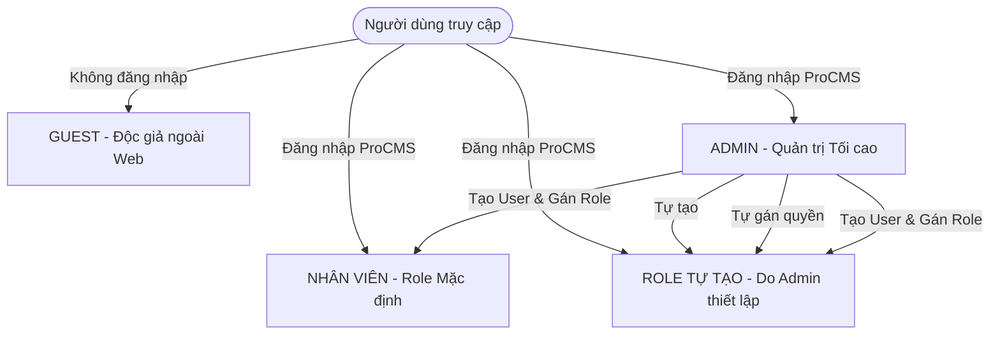

# BẢNG ĐẶC TẢ TÍNH NĂNG THEO TỪNG VAI TRÒ (ROLE)
## HỆ THỐNG CỔNG TIN TỨC & MÃ GIẢM GIÁ AFFILIATE (BARGORYA & PROCMS)

---

## 1. NGUYÊN TẮC VẬN HÀNH PHÂN QUYỀN ĐỘNG (DYNAMIC RBAC)

Hệ thống được thiết kế theo mô hình **Phân quyền Động 100% linh hoạt**:
* **Không cố định cứng các vai trò**: Quản trị viên có toàn quyền tự tổ chức bộ máy nhân sự theo 3 bước:
  1. **Tự tạo Role mới**: Đặt tên Role bất kỳ theo nhu cầu của công ty.
  2. **Tự gán tính năng vào Role**: Tự tích chọn các quyền hạn cụ thể cho Role đó trên bảng ma trận tính năng.
  3. **Tự thêm User và gán vào Role**: Tạo tài khoản nhân viên mới và chọn Role tương ứng để áp dụng quyền ngay lập tức.
* **Hệ thống khởi tạo sẵn 2 Role mặc định ban đầu**:
  * **`Admin`**: Toàn quyền tối cao quản trị hệ thống, quản lý tài khoản và phân quyền.
  * **`Nhân viên`**: Vai trò vận hành cơ sở (quản lý bài viết, store, mã giảm giá được phân công).
* **Người dùng công khai ngoài website**:
  * **`Guest`**: Độc giả vãng lai không cần tài khoản, truy cập từ Google Search hoặc Mạng xã hội.

---

## 2. CHI TIẾT TÍNH NĂNG THEO TỪNG VAI TRÒ (ROLES)



---

### VAI TRÒ 1: GUEST (Độc giả / Khách vãng lai ngoài Web)
> **Phạm vi:** Người dùng truy cập website qua trình duyệt web trên máy tính hoặc điện thoại (đặc biệt là nhấp link từ TikTok Bio, Facebook Post, Instagram Bio, YouTube...). **Hoàn toàn không cần tài khoản.**

| Nhóm tính năng | Chi tiết tính năng người dùng được trải nghiệm |
| :--- | :--- |
| **1. Khám phá Trang chủ** | - Xem bài viết tiêu điểm lớn nhất (Hero Featured).<br>- Xem 4 bài viết chọn lọc ban biên tập (Editor Pick).<br>- Xem các khối chuyên mục phân tầng (*Business, Tech, Climate, US Politics...*).<br>- Đọc dải tin vắn cuộn ngang khẩn cấp (*Flash News*).<br>- Lọc xem bài viết theo các hashtag thịnh hành (*Trending #Tags*). |
| **2. Đọc Tin tức & Đánh giá (Review)** | - Đọc bài viết chi tiết chuẩn giao diện tạp chí hiện đại.<br>- Xem bảng so sánh thông số kỹ thuật, hộp ưu/nhược điểm (Pros & Cons).<br>- Nhấp vào các nút kêu gọi mua hàng (Affiliate CTA Box: *"Buy Now"*, *"Check Price"*) để chuyển sang trang mua sản phẩm. |
| **3. Săn Mã giảm giá (Trang Store)** | - Xem danh sách mã giảm giá của từng nhãn hàng (Store) cập nhật mới nhất.<br>- Lọc ưu đãi theo các Tab: `All` (Tất cả), `Verified` (Mã đã kiểm tra dùng tốt), `Codes` (Chỉ lấy mã nhập tay), `Deals` (Ưu đãi kích hoạt tự động).<br>- **Cơ chế Lấy Mã "Get Code":**<br>  + Khi bấm nút: Tự động mở tab mới chuyển hướng sang website nhãn hàng (chứa mã hoa hồng affiliate của bạn).<br>  + Trên màn hình hiện tại: Bật Popup chứa mã giảm giá và nút **"Tap To Copy"** (1 chạm sao chép ngay vào bộ nhớ máy).<br>- Đọc bài giới thiệu chi tiết thương hiệu (*About Store: Who We Are, What We Offer, Why Choose Us, Our Mission & Vision*). |
| **4. Tương tác với Cửa hàng** | - Đánh giá sao độ uy tín của Store (Star Rating & Rate it).<br>- Đăng ký nhận thông báo mã mới qua email (*Get Coupon Alert*).<br>- Nhấp nút chia sẻ trang store lên Facebook, Zalo, X, Telegram hoặc Copy Link store. |
| **5. Tìm kiếm & Trang tĩnh** | - Tìm kiếm nhanh bài viết tin tức, bài review, tên store hoặc mã giảm giá.<br>- Xem các trang thông tin: *About Us, Contact Us, Privacy Policy, Terms, Affiliate Disclosure*.<br>- Gửi tin nhắn liên hệ / phản hồi tới ban quản trị qua Form Contact. |

---

### VAI TRÒ 2: ADMIN (Quản trị viên Tối cao - Default Role)
> **Phạm vi:** Người nắm giữ quyền hạn cao nhất trong hệ thống ProCMS, toàn quyền can thiệp hệ thống và nhân sự.

| Nhóm tính năng | Chi tiết tính năng Admin được thực hiện |
| :--- | :--- |
| **1. Quản trị Role & Phân quyền (RBAC)** | - **Tự tạo Role mới**: Thêm bất kỳ vai trò mới nào theo nhu cầu tổ chức.<br>- **Tự gán tính năng vào Role**: Tự tích chọn từng quyền hạn (Xem, Thêm, Sửa, Xóa, Clone, Duyệt) cho từng module vào Role đó.<br>- Chỉnh sửa tên, mô tả và ma trận quyền của Role.<br>- Xóa các Role tùy biến đã tạo (kèm kiểm tra an toàn nếu Role đang có User sử dụng). |
| **2. Quản lý Tài khoản & Phân vai trò** | - **Tự thêm User**: Tạo tài khoản cho nhân sự mới.<br>- **Gán Role cho User**: Chọn Role từ danh sách để gán quyền cho User.<br>- Khóa / Mở khóa tài khoản (Active/Inactive), đổi mật khẩu nhân viên.<br>- Cấp quyền Super Admin (bypass toàn bộ kiểm tra quyền). |
| **3. Cài đặt Kỹ thuật & Hệ thống** | - Cài đặt chung: Tên trang (Site Name), Khẩu hiệu (Slogan), Logo chính, Logo footer, Favicon.<br>- Bật/Tắt chặn Google Index (Noindex/Nofollow).<br>- Bật/Tắt tính năng tìm kiếm Store.<br>- Cài đặt chân trang, thông tin bản quyền và liên hệ. |
| **4. Cài đặt SEO & Tracking Script** | - Cấu hình Meta Title, Keywords, Description mặc định toàn trang.<br>- **Nhúng thẻ Meta xác minh**: Nhập các thẻ xác minh đối tác affiliate (*PartnerBoost, Impact, fo-verify, ClicksNova...*).<br>- **Nhúng mã Tracking toàn diện**: Nhúng mã script vào `<head>` (Google Analytics GTAG, Google Tag Manager, Pixel), nhúng mã vào `<body>` và chân trang `</body>`. |
| **5. Quản lý Quảng cáo (Ads Banner)** | - Cấu hình hiển thị banner quảng cáo: Header 728x90, Sidebar 300x250, In-article 300x600.<br>- Chọn hiển thị dạng: Ảnh upload kèm link affiliate hoặc Mã Script Google AdSense. |
| **6. Toàn quyền Nội dung & Affiliate** | - Sở hữu 100% quyền hạn của tất cả các module: Danh mục, Bài viết, Store, Offer, Menu, Trang tĩnh, Feedback, Thư viện File. |

---

### VAI TRÒ 3: NHÂN VIÊN (Staff - Default Role)
> **Phạm vi:** Vai trò mặc định ban đầu dành cho nhân sự vận hành nội dung hàng ngày. Được cấp sẵn các tính năng biên tập, không có quyền can thiệp hệ thống và nhân sự.

| Nhóm tính năng | Những tính năng ĐƯỢC PHÉP làm | Những tính năng BỊ KHÓA / ẨN |
| :--- | :--- | :--- |
| **1. Bài viết / Tin tức** | - Xem danh sách bài viết.<br>- Soạn thảo và đăng bài viết mới.<br>- Chỉnh sửa bài viết được phân công.<br>- Nhân bản (Clone) bài viết nhanh.<br>- Định dạng văn bản chuyên nghiệp bằng CKEditor: chèn ảnh, bảng so sánh sản phẩm, link affiliate, nút mua hàng. | - Không được xóa bài viết của người khác (trừ khi Admin cấp thêm quyền). |
| **2. Cửa hàng (Store)** | - Xem danh sách cửa hàng.<br>- Thêm cửa hàng mới vào hệ thống.<br>- Cập nhật thông tin cửa hàng, logo, bài viết About Store chuẩn SEO.<br>- Cấu hình ảnh Social Card preview riêng cho từng Store. | - Bị ẩn/khóa các mục nhạy cảm: không xem thông tin tài khoản portal affiliate bí mật, không đổi nhân sự Ads. |
| **3. Mã giảm giá (Offer)** | - Xem danh sách ưu đãi & coupon.<br>- Thêm mới mã giảm giá, mức giảm (% off, $ off), hạn dùng.<br>- Nhập link tracking affiliate.<br>- Nhân bản (Clone) mã giảm giá tương tự. | - Không được tự ý xóa mã giảm giá diện rộng. |
| **4. Thư viện File & Media** | - Tải hình ảnh bài viết, logo cửa hàng lên hệ thống.<br>- Copy link ảnh để chèn vào nội dung bài viết. | - Không được xóa các thư mục ảnh hệ thống của Admin. |
| **5. Danh mục & Menu** | - Xem cây danh mục tin tức và store.<br>- Chọn danh mục khi đăng bài viết/store. | - Không được thay đổi cấu trúc Menu chính và Menu chân trang toàn hệ thống. |
| **6. Quản trị & Cài đặt** | - Hoàn toàn không có quyền. | - **BỊ ẨN HOÀN TOÀN TRÊN MENU:** Không thấy mục Cài đặt hệ thống, Cài đặt SEO, Chèn mã Tracking, Quản lý User, Quản lý Role. |

---

### VAI TRÒ 4: CÁC ROLE TỰ TẠO (Custom Roles do Admin thiết lập)
> **Đặc điểm:** Quản trị viên tự đặt tên, tự tích chọn quyền phù hợp với mô hình kinh doanh của công ty.

Dưới đây là một số ví dụ thực tế về các Role mà Admin có thể tạo:

#### Ví dụ 1: Role `Cộng tác viên Content` (Chuyên viết bài Review)
* **Mục đích:** Thuê ngoài người viết bài đánh giá sản phẩm.
* **Tính năng được gán:**
  * Chỉ thấy mục **Tin tức / Bài viết** trên menu.
  * Được quyền: Xem danh sách bài viết, Thêm bài viết mới, Chỉnh sửa bài viết của chính mình, Tải ảnh lên thư viện.
  * Bị khóa: Không được xuất bản trực tiếp (phải chờ Admin duyệt), không được xóa bài, không thấy mục Store, Coupon, User, Cài đặt.

#### Ví dụ 2: Role `Nhân viên Săn Deals / Coupon` (Chuyên cập nhật mã giảm giá)
* **Mục đích:** Nhân sự chuyên tìm kiếm và cập nhật mã giảm giá từ các thương hiệu hàng ngày.
* **Tính năng được gán:**
  * Chỉ thấy mục **Store** và mục **Offer** trên menu.
  * Được quyền: Thêm/Sửa mã giảm giá, kiểm tra và đánh dấu `Verified` (Mã đã kiểm tra dùng được), nhập link affiliate tracking, cập nhật trạng thái hết hạn.
  * Bị khóa: Không can thiệp vào bài viết tin tức, không vào Cài đặt hệ thống.

#### Ví dụ 3: Role `Chuyên viên Tiếp thị & Ads` (Affiliate & Ads Ops)
* **Mục đích:** Nhân sự phụ trách đàm phán mạng affiliate và chạy quảng cáo kéo traffic.
* **Tính năng được gán:**
  * Thấy mục **Store** và **Cấu hình Ads**.
  * Được quyền: Xem thông tin hoa hồng (Commission %), theo dõi số lượt visit/click của từng Store, gán tài khoản Ads phụ trách, lấy link rút gọn có sẵn mã UTM chiến dịch để đi kéo traffic trên TikTok/Facebook.

#### Ví dụ 4: Role `Chuyên viên SEO` (SEO Specialist)
* **Mục đích:** Tối ưu Onpage và kiểm tra sitemap, thẻ meta toàn trang.
* **Tính năng được gán:**
  * Thấy mục **Bài viết**, **Store**, **Cài đặt SEO**.
  * Được quyền: Tối ưu Meta Title, Meta Description, Meta Keywords cho từng bài viết và từng Store; cấu hình thẻ Meta xác minh search console.

---

## 3. BẢNG MA TRẬN PHÂN QUYỀN TỔNG THỂ (PERMISSION MATRIX)

Bảng đối chiếu chi tiết quyền hạn giữa các Role trong hệ thống:

| Tên Module | Mã quyền kỹ thuật (Permission Code) | GUEST (Web) | NHÂN VIÊN (Default) | ADMIN (Default) | ROLE TỰ TẠO (Tùy chọn) |
| :--- | :--- | :---: | :---: | :---: | :---: |
| **Đăng nhập ProCMS** | `backend.access` | ❌ | ✅ | ✅ | Admin tự tích |
| **Danh mục (Category)** | `category.view` | ✅ (Xem web) | ✅ | ✅ | Admin tự tích |
| | `category.create` | ❌ | ❌ | ✅ | Admin tự tích |
| | `category.update` | ❌ | ❌ | ✅ | Admin tự tích |
| | `category.delete` | ❌ | ❌ | ✅ | Admin tự tích |
| **Bài viết (Post)** | `post.view` | ✅ (Xem web) | ✅ | ✅ | Admin tự tích |
| | `post.create` | ❌ | ✅ | ✅ | Admin tự tích |
| | `post.update` | ❌ | ✅ (Bài mình) | ✅ (Tất cả) | Admin tự tích |
| | `post.delete` | ❌ | ❌ | ✅ | Admin tự tích |
| | `post.clone` | ❌ | ✅ | ✅ | Admin tự tích |
| | `post.publish` | ❌ | ✅ | ✅ | Admin tự tích |
| **Cửa hàng (Store)** | `store.view` | ✅ (Xem web) | ✅ | ✅ | Admin tự tích |
| | `store.create` | ❌ | ✅ | ✅ | Admin tự tích |
| | `store.update` | ❌ | ✅ | ✅ | Admin tự tích |
| | `store.delete` | ❌ | ❌ | ✅ | Admin tự tích |
| | `store.affiliate_intel` | ❌ | ❌ | ✅ | Admin tự tích |
| | `store.ads_assign` | ❌ | ❌ | ✅ | Admin tự tích |
| **Mã giảm giá (Offer)** | `offer.view` | ✅ (Xem web) | ✅ | ✅ | Admin tự tích |
| | `offer.create` | ❌ | ✅ | ✅ | Admin tự tích |
| | `offer.update` | ❌ | ✅ | ✅ | Admin tự tích |
| | `offer.delete` | ❌ | ❌ | ✅ | Admin tự tích |
| | `offer.verify` | ❌ | ✅ | ✅ | Admin tự tích |
| | `offer.clone` | ❌ | ✅ | ✅ | Admin tự tích |
| **Trang tĩnh (Pages)** | `page.manage` | ❌ | ❌ | ✅ | Admin tự tích |
| **Menu điều hướng** | `menu.manage` | ❌ | ❌ | ✅ | Admin tự tích |
| **Phản hồi (Feedback)** | `feedback.view` | ❌ (Chỉ gửi) | ❌ | ✅ | Admin tự tích |
| | `feedback.delete` | ❌ | ❌ | ✅ | Admin tự tích |
| **Thư viện File** | `file.upload` | ❌ | ✅ | ✅ | Admin tự tích |
| | `file.delete` | ❌ | ❌ | ✅ | Admin tự tích |
| **Quản lý Tài khoản** | `user.view` | ❌ | ❌ | ✅ | Admin tự tích |
| | `user.create` | ❌ | ❌ | ✅ | Admin tự tích |
| | `user.update` | ❌ | ❌ | ✅ | Admin tự tích |
| | `user.delete` | ❌ | ❌ | ✅ | Admin tự tích |
| **Quản lý Vai trò** | `role.manage` | ❌ | ❌ | ✅ | ❌ (Chỉ Admin) |
| **Cài đặt Hệ thống** | `setting.general` | ❌ | ❌ | ✅ | ❌ (Chỉ Admin) |
| | `setting.seo` | ❌ | ❌ | ✅ | Admin tự tích |
| | `setting.tracking` | ❌ | ❌ | ✅ | ❌ (Chỉ Admin) |
| | `setting.ads` | ❌ | ❌ | ✅ | Admin tự tích |

---

## 4. HƯỚNG DẪN THAO TÁC CỦA ADMIN TRÊN GIAO DIỆN PROCMS

```
[BƯỚC 1: TẠO ROLE]
Menu "Quản lý user" -> "Group / Role" -> Bấm "+ Thêm mới"
  -> Nhập Tên Role (ví dụ: "Cộng tác viên Content")
  -> Nhập Mã Role (ví dụ: "collaborator")

[BƯỚC 2: GÁN TÍNH NĂNG VÀO ROLE]
Tại trang chỉnh sửa Role:
  -> Xuất hiện Bảng Ma trận Checkbox các tính năng
  -> Tích chọn các quyền muốn cấp (ví dụ: Tích chọn "Truy cập backend", "Bài viết: Thêm, Sửa", "File: Upload")
  -> Bấm "Cập nhật" để lưu lại

[BƯỚC 3: THÊM USER VÀ GÁN ROLE]
Menu "Quản lý user" -> "User" -> Bấm "+ Thêm mới"
  -> Nhập Họ tên, Email, Mật khẩu, Số điện thoại của nhân viên
  -> Tại ô dropdown "Group Admin / Role": Chọn Role vừa tạo ("Cộng tác viên Content")
  -> Bấm "Cập nhật"
  ==> Nhân viên đăng nhập vào hệ thống sẽ CHỈ THẤY các tính năng đã được cấp phép!
```

---
*Tài liệu này là chuẩn hướng dẫn nghiệp vụ và thiết kế phân quyền cho hệ thống.*
